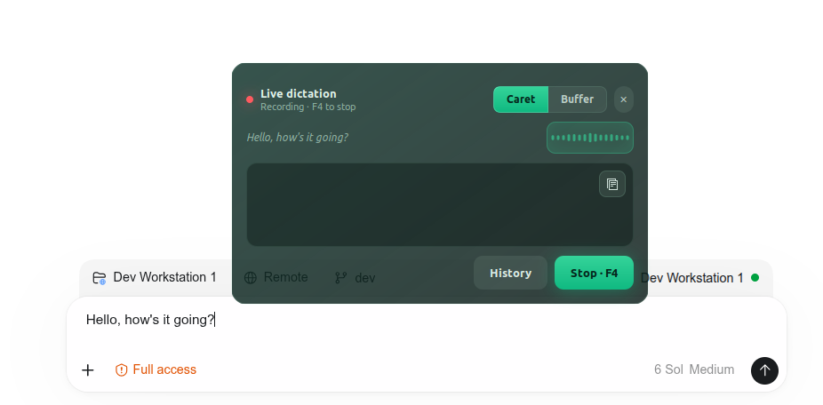

# Live Dictation

> **Speak naturally. Watch the words land.**

Live Dictation is a small, always-on-top voice panel for GNOME on Linux. It streams Azure OpenAI transcription as you speak—straight into the app you are using, or into a buffer you can review and copy.

## One shortcut. Two ways to write.

| **Caret** | **Buffer** |
| :-- | :-- |
| Words appear at the active text cursor while you keep working. | Words collect in an editable panel. Stop, review, then copy with one click. |

Switch destinations during a recording. The translucent GTK panel stays above your windows, shows a live audio meter, and keeps every session’s audio and transcript in a local history.

**[Get started →](docs/SETUP.md)** · **[See how it works →](docs/ARCHITECTURE.md)**

## Made to stay out of the way

- **Immediate feedback.** Partial transcription appears while you speak.
- **Your choice of destination.** Use the active caret for speed or the buffer for control.
- **A record you can revisit.** Audio, transcript, and session events are saved locally.
- **A native desktop feel.** GTK 3, a draggable glass panel, a compact audio meter, and a single shortcut to start or stop.

## Bring your own Azure deployment

Clone the repo, install the Linux dependencies, and point a private user config at your Azure OpenAI realtime transcription deployment. Credentials and recordings stay outside Git. The [setup guide](docs/SETUP.md) walks through the service, shortcut, and optional GNOME focus helper; [architecture notes](docs/ARCHITECTURE.md) explain the streaming and storage paths.

Built and tested on Ubuntu with GNOME, GTK 3, and XWayland. Audio is sent to your configured Azure OpenAI resource for transcription.
