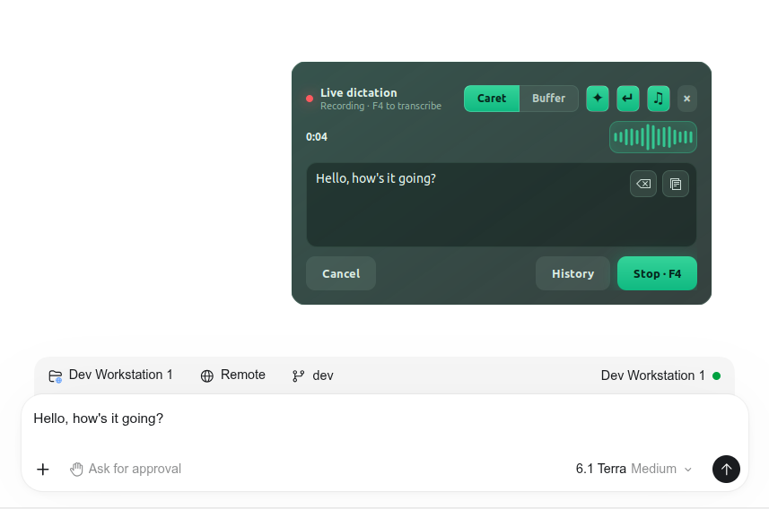

# Live Dictation

> **Speak naturally. Press stop. Let the words land.**

Live Dictation is a small, always-on-top voice panel for GNOME on Linux. It records your speech locally, then transcribes it when you stop. The finished text goes into the app you are using or an editable buffer.

## One shortcut. Two ways to write.

| **Caret** | **Buffer** |
| :-- | :-- |
| The finished transcript appears at the active text cursor when you stop recording. | The finished transcript goes into an editable panel you can review and copy. |

Switch destinations during a recording. The translucent GTK panel stays above your windows, shows a live audio meter, and keeps every session’s audio and transcript in a local history.

The panel opens at the top right of your primary monitor. Drag it elsewhere while it is open; switching between Caret and Buffer keeps that position.

**[Get started →](docs/SETUP.md)** · **[See how it works →](docs/ARCHITECTURE.md)**

## A few thoughtful controls

- **A little polish on your desktop.** A draggable, always-on-top GTK panel with translucent forest-green glass and a live audio meter that shows when the microphone hears you.
- **Speak at your own pace.** Recording continues through pauses. When you stop, the app transcribes the whole take and inserts one complete result.
- **Write where you want.** Paste into the active caret, or collect text in an editable buffer to review and copy. Switch destinations while recording.
- **Keep the music, or pause it.** Toggle automatic media pause for dictation; the app resumes only the players it paused.
- **Choose your edit.** Grammar fixes spelling and punctuation while keeping your wording. Format makes rambling speech clearer and more concise. Both use AI; Format leaves sending to you.
- **Choose when to press Enter.** In Caret mode, enable automatic Enter for chat apps that send on Enter. End with **“hold”** to keep a draft when it is on, or **“boom”** to press Enter when it is off. The spoken cue is removed from the delivered text.
- **Find it again.** Browse and copy past transcripts in the popup. Audio, text, and timing history stay on your machine.
